# Diagramme de Classes — RiskGuard (Scoring LBC/FT)

## Description

L'application **RiskGuard** est un système de scoring LBC/FT pour IMF béninoises. Architecture 3-tiers : **Routers FastAPI → Services métier → Modèles ORM**.

**16 entités SQLAlchemy** réparties en 5 domaines :

- **Domaine Client** : `Customer` (entité centrale) — `CustomerAccount` (comptes), `CustomerDoc` (documents KYC), `Transaction` (opérations)
- **Domaine Scoring** : `Score` (résultat 0–100), `ScoringCriteria` (poids C1–C6), `RiskThreshold` (seuils), `RiskZone` (zones à risque)
- **Domaine Référentiel** : `Country` (pays UEMOA/frontalier/FATF), `PepEntry` (PEP)
- **Domaine Alerte & Audit** : `Alert` (6 types, cycle OPEN→CLOSED), `AuditLog` (traçabilité)
- **Domaine Auth & Admin** : `User` (agents), `UserRole` (permissions JSON), `AppSetting` (paramètres)

**Services métier** : `ScoringEngine` (moteur 6 critères C1–C6), `alert_service`, `customer_service`, `beneficiaire_service`, `export_service`, `audit_service`.

## Diagramme

```mermaid
---
title: RiskGuard — Diagramme de Classes Complet (Modèles + Services)
---
classDiagram

    %% ═══════════════════════════════════════════════════════════════════
    %% COUCHE MODÈLES (SQLAlchemy ORM) — 16 entités
    %% ═══════════════════════════════════════════════════════════════════

    %% ─── 1. DOMAINE CLIENT ────────────────────────────────────────────

    class Customer {
        +UUID id
        +String nom
        +String prenom
        +Date date_naissance
        +String phone
        +String email
        +String profession_code
        +String profession_name
        +String profession_risk
        +Numeric revenus_declares
        +String city
        +String region
        +String latitude
        +String longitude
        +Int zone_geo FK
        +Int pays FK
        +Boolean statut_pep
        +UUID pep_verified_by FK
        +String kyc_level
        +Int kyc_completion
        +String status
        +DateTime date_creation
        +DateTime updated_at
        +__repr__() str
    }

    class CustomerAccount {
        +UUID id
        +UUID client_id FK
        +String type_compte
        +Numeric solde_moyen
        +Date date_ouverture
        +String status
        +DateTime created_at
        +__repr__() str
    }

    class CustomerDoc {
        +UUID id
        +UUID client_id FK
        +String type_doc
        +String numero
        +Date date_expiration
        +UUID verified_by FK
        +DateTime created_at
        +valide() bool (property)
        +__repr__() str
    }

    class Transaction {
        +UUID id
        +UUID compte_id FK
        +Numeric montant
        +String devise
        +String type_op
        +DateTime date_op
        +String canal
        +String origine
        +String destination
        +Int origine_pays_id FK
        +Int destination_pays_id FK
        +__repr__() str
    }

    %% ─── 2. DOMAINE SCORING ───────────────────────────────────────────

    class Score {
        +UUID id
        +UUID client_id FK
        +Int score_global
        +JSONB detail_json
        +String categorie
        +Boolean is_current
        +DateTime date_calcul
        +String calcule_par
        +__repr__() str
    }

    class ScoringCriteria {
        +Int id
        +String code
        +Numeric weight
        +String name
        +String description
        +UUID updated_by FK
        +DateTime updated_at
        +__repr__() str
    }

    class RiskThreshold {
        +Int id
        +String category
        +Int score_min
        +Int score_max
        +String action
        +DateTime updated_at
        +__repr__() str
    }

    class RiskZone {
        +Int id
        +String name
        +String risk_level
        +String source
        +String description
        +__repr__() str
    }

    %% ─── 3. DOMAINE RÉFÉRENTIEL ───────────────────────────────────────

    class Country {
        +Int id
        +String code_iso
        +String name
        +Boolean is_uemoa
        +Boolean is_border
        +Boolean is_fatf
        +__repr__() str
    }

    class PepEntry {
        +UUID id
        +Int pays FK
        +String nom
        +String prenom
        +String fonction
        +Date date_debut
        +Date date_fin
        +String source
        +Boolean active
        +__repr__() str
    }

    %% (Événement SQLAlchemy hors classe)
    class PepEntryEvents {
        +compute_active_pep(mapper, connection, target) void (before_insert, before_update)
    }

    %% ─── 4. DOMAINE ALERTE & AUDIT ────────────────────────────────────

    class Alert {
        +UUID id
        +UUID client_id FK
        +UUID clos_par FK
        +UUID score_id FK
        +String beneficiaire_nom
        +JSONB tx_ids
        +String type_alerte
        +String statut
        +String decision
        +Boolean sar_declare
        +DateTime date_creation
        +DateTime date_cloture
        +__repr__() str
    }

    class AuditLog {
        +UUID id
        +UUID user_id FK
        +UUID client_id FK
        +String action
        +DateTime timestamp
        +String ip_address
        +__repr__() str
    }

    %% ─── 5. DOMAINE AUTH & ADMIN ──────────────────────────────────────

    class User {
        +UUID id
        +String login
        +String password_hash
        +Int role_id FK
        +Boolean is_active
        +DateTime last_login
        +DateTime created_at
        +__repr__() str
    }

    class UserRole {
        +Int id
        +String name
        +JSONB permissions
        +__repr__() str
    }

    class AppSetting {
        +Int id
        +String key
        +Float value
        +String label
        +String description
        +DateTime updated_at
        +__repr__() str
    }

    %% ═══════════════════════════════════════════════════════════════════
    %% COUCHE SERVICES (Business Logic)
    %% ═══════════════════════════════════════════════════════════════════

    class ScoringEngine {
        +Session db
        -dict _weights
        -list _thresholds
        -bool _smurfing_detected
        +__init__(db_session: Session)
        +calculate_score(customer_id: UUID) dict
        -_load_weights() void
        -_load_thresholds() void
        -_score_c1(customer: Customer) float
        -_score_c2(customer: Customer) float
        -_score_c3(customer: Customer) float
        -_score_c4(customer: Customer) float
        -_score_c5(customer: Customer) float
        -_score_c6(customer: Customer) float
        -_detect_smurfing(transactions: list, revenus_mensuel: float) bool
        -_detect_duplicates(transactions: list) int
        -_get_category(score: int) str
        -_get_zone(customer: Customer) RiskZone
        -_get_country(customer: Customer) Country
        -_get_risk_country_ids() set
        -_avg_monthly_tx(customer: Customer) float
        +_normalize_name(text: str) str (static)
    }

    class customer_service {
        +compute_kyc_completion(customer: Customer) int$
        +determine_kyc_level(completion: int) str$
    }

    class alert_service {
        +create_alert(db, customer_id, alert_type, decision, score_id, tx_ids, beneficiaire_nom) Alert$
        +has_open_alert(db, customer_id, alert_type) bool$
        +create_if_not_open(db, client_id, type_alerte, ...) Alert$
        +create_score_alert_if_needed(db, customer_id, global_score, ...) Alert$
        +create_pep_alert_if_needed(db, customer_id, c5_score, ...) Alert$
        +create_smurfing_alert_if_needed(db, customer_id, ...) Alert$
        +create_kyc_alert_if_needed(db, customer_id, kyc_completion, ...) Alert$
    }

    class beneficiaire_service {
        +check_and_alert(transaction: Transaction, db: Session) void$
        -_normalize(text: str) str$
    }

    class export_service {
        +generate_customer_pdf(db, customer_id, agent) bytes$
        +generate_transactions_csv(db, customer_id, days) bytes$
        +generate_sar_pdf(db, alert_id, agent) bytes$
        -_build_styles() dict$
        -_header_block(styles, export_date, agent_name) list$
        -_footer_elements(styles, page_label, agent_name) list$
        -_section_table(title, bg) Table$
        -_standard_table(headers, rows, col_widths) Table$
        -_build_bar_chart(detail) Drawing$
        -_score_color(score) Color$
        -_category_label(category) str$
        -_fmt_date(d) str$
        -_fmt_datetime(d) str$
        -_fmt_montant(m) str$
    }

    class audit_service {
        +log_action(db, user_id, action, client_id, ip, resource_type, resource_id, ip_address) void$
        +ACTION_LOGIN, ACTION_LIST_CLIENTS, ACTION_VIEW_CUSTOMER ...$
        +ACTION_SCORING_CALCULATE, ACTION_SCORING_RESCORE, ACTION_SCORING_RESCORE_ALL ...$
        +ACTION_EXPORT_PDF, ACTION_EXPORT_CSV, ACTION_IMPORT_PEP ...$
        +RESOURCE_CUSTOMER, RESOURCE_SCORE, RESOURCE_ALERT$
    }

    %% ═══════════════════════════════════════════════════════════════════
    %% RELATIONS ENTRE MODÈLES
    %% ═══════════════════════════════════════════════════════════════════

    Customer "1" --> "0..N" CustomerAccount : accounts
    Customer "1" --> "0..N" CustomerDoc : documents
    Customer "1" --> "0..N" Score : scores
    Customer "1" --> "0..N" Alert : alerts
    Customer "N" --> "1" RiskZone : risk_zone
    Customer "N" --> "1" Country : country
    Customer "N" --> "0..1" User : pep_verified_by

    CustomerAccount "1" --> "0..N" Transaction : transactions
    CustomerAccount "N" --> "1" Customer : customer

    Transaction "N" --> "0..1" Country : origine_pays
    Transaction "N" --> "0..1" Country : destination_pays
    Transaction "N" --> "1" CustomerAccount : account

    Score "1" --> "0..N" Alert : alerts
    Score "N" --> "1" Customer : customer

    Alert "N" --> "1" Customer : customer
    Alert "N" --> "0..1" User : closed_by
    Alert "N" --> "0..1" Score : score

    AuditLog "N" --> "1" User : user
    AuditLog "N" --> "0..1" Customer : customer

    User "N" --> "1" UserRole : role
    User "1" --> "0..N" AuditLog : audit_logs

    PepEntry "N" --> "0..1" Country : country
    ScoringCriteria "N" --> "0..1" User : updated_by

    %% ═══════════════════════════════════════════════════════════════════
    %% DÉPENDANCES SERVICES → MODÈLES
    %% ═══════════════════════════════════════════════════════════════════

    ScoringEngine ..> Customer : lit
    ScoringEngine ..> Transaction : lit
    ScoringEngine ..> Country : lit
    ScoringEngine ..> PepEntry : lit
    ScoringEngine ..> RiskZone : lit
    ScoringEngine ..> CustomerDoc : lit
    ScoringEngine ..> ScoringCriteria : lit
    ScoringEngine ..> RiskThreshold : lit
    ScoringEngine ..> CustomerAccount : lit

    alert_service ..> Alert : crée/gère
    audit_service ..> AuditLog : crée

    beneficiaire_service ..> alert_service : appelle
    beneficiaire_service ..> Transaction : lit
    beneficiaire_service ..> CustomerAccount : lit

    export_service ..> Customer : lit
    export_service ..> Score : lit
    export_service ..> Alert : lit
    export_service ..> Transaction : lit
    export_service ..> CustomerAccount : lit
    export_service ..> Country : lit
    export_service ..> RiskZone : lit
    export_service ..> CustomerDoc : lit
    export_service ..> User : lit

    customer_service ..> Customer : lit
    customer_service ..> CustomerDoc : lit
```

